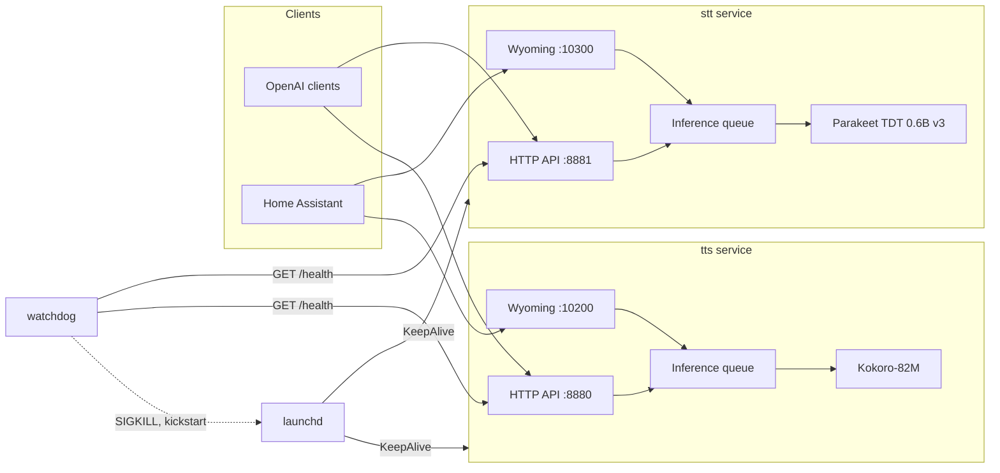

# voiced

Run speech-to-text and text-to-speech on your Mac for Home Assistant voice
control or any app that speaks the OpenAI audio API. Models stay loaded on
the Apple Silicon GPU, so spoken replies start in about 100 ms with the
default voice. voiced runs as two
services, one for each direction, under launchd plus a watchdog: they start
at boot without anyone logging in and restart themselves after a crash or a
hang. Home Assistant talks to it over
Wyoming, the protocol its Assist pipelines use for local speech services.

**Status:** pre-alpha. Speech-to-text with Parakeet TDT 0.6B v3,
text-to-speech with Kokoro-82M and the optional Soprano-80M voice, the HTTP
API, the Wyoming listeners, the installer, the watchdog and `voiced doctor`
are in place. Nothing has been released yet, and the numbers below come from
one machine. Expect breaking changes.

## Quickstart

Requirements: an Apple Silicon Mac, macOS 14 or newer,
[Homebrew](https://brew.sh) and [uv](https://docs.astral.sh/uv/).

There will be three ways to install, and all three set up the same
`~/.voiced` and the same launchd plists
([ADR 0017](docs/decisions/0017-homebrew-packaging.md)):

- **The menu bar app, from a Homebrew cask**, for most people: the app
  installs the services itself. It needs a signed release (a Developer ID
  and v0.1.0), so it does not exist yet.
- **The Homebrew formula**, for headless Macs and terminal use:
  `brew install julianbeaulieu/voiced/voiced`, then `voiced install`. It
  needs the formula in the [tap](https://github.com/JulianBeaulieu/homebrew-voiced),
  which it is not in yet, and `--HEAD` until v0.1.0. To try it now from a
  local tap, see [packaging/homebrew/README.md](packaging/homebrew/README.md).
- **From a checkout**, which is what works today:

```sh
brew install espeak-ng
brew install uv    # skip if `uv --version` already works
```

Then:

```sh
git clone https://github.com/JulianBeaulieu/voiced ~/voiced
uv tool install --python 3.12 ~/voiced
uv tool update-shell
```

`--python 3.12` matters: without it uv uses its default interpreter, which
can be one voiced does not support (it needs 3.11 to 3.13). With 3.10 the
install fails with "requirements are unsatisfiable"; with 3.14 it can
succeed on a Python voiced is not tested on, which `voiced doctor` then
reports as a failure. `uv tool install` puts the
`voiced` command in `~/.local/bin`, which is often not on your `PATH` yet;
`uv tool update-shell` adds it to your shell's startup file (`~/.zshenv` for
the default zsh). Open a new terminal, then:

```sh
voiced install --source ~/voiced
```

`uv tool install` gives you the `voiced` command but not the engines;
`--source` makes `voiced install` build the service environment, with the
engines, from your checkout into `~/.voiced/envs/`, every package at the
version and hash in the checkout's lock, on a Python 3.12 that uv
downloads into `~/.voiced/python`. It then points `~/.voiced/bin/voiced`
at that environment, downloads the models into the
Hugging Face cache, and prints the one command you run as root. The models
are about 2.7 GB; with the Python
environment and uv's cache, plan for about 4.5 GB of disk and several minutes
on the first install. A warning about `HF_TOKEN` along the way is harmless:
the models are public and need no Hugging Face account. Run the printed
command; it looks like this, with the path of the environment voiced runs
from:

```sh
sudo /bin/bash ~/.voiced/envs/<id>/lib/python3.12/site-packages/voiced/launchd/voiced-privileged.sh install <you>
```

That script is the one the menu bar app runs as root too. Given only your
user name, it writes the three plists into `/Library/LaunchDaemons` from
fixed values (the daemons run as your user, `UserName`, and run
`~/.voiced/bin/voiced`), then loads them. `voiced install` prints the line
only if that file and every folder on the way to it belong to you or root
and no other account can change them (a Homebrew another admin owns does
not qualify). Read it first if you like. voiced never runs anything as root
itself. Then:

```sh
voiced status
```

Both services report `ok` once their model is warm, a few seconds after the
models are on disk. Try them:

```sh
curl -s http://127.0.0.1:8880/v1/audio/speech \
  -H 'Content-Type: application/json' \
  -d '{"model": "kokoro", "input": "Hello from voiced.", "voice": "af_heart"}' \
  -o hello.wav

curl -s http://127.0.0.1:8881/v1/audio/transcriptions \
  -F file=@hello.wav -F model=parakeet
```

`voiced install --source ~/voiced --dry-run` shows everything it would do
without writing anything. To remove voiced again, see `voiced uninstall` in
[docs/operations.md](docs/operations.md#commands).

For a menu bar icon that shows whether both services are up, restarts them,
opens the logs and changes the common settings, build the menu bar app from
the same checkout with `~/voiced/menubar/Scripts/bundle.sh` and open
`~/voiced/menubar/build/voiced.app`. It needs Swift 6 (Xcode 16 or newer)
until there is a signed release, and it talks only to the watchdog's local
control socket, never to the network. See
[menubar/README.md](menubar/README.md).

## What you get

| Endpoint | Service | Port | Purpose |
|---|---|---|---|
| `POST /v1/audio/transcriptions` | stt | 8881 | Transcribe a file (json, text, verbose_json, srt, vtt) |
| `WS /v1/audio/transcriptions/stream` | stt | 8881 | Live transcription with partial and final events |
| `POST /v1/audio/speech` | tts | 8880 | Synthesize text as wav, pcm, mp3 or opus; every format streams |
| `GET /v1/audio/voices` | tts | 8880 | List voices |
| `GET /v1/models` | both | | The model this service runs, its languages and license |
| `GET /health` | both | | Model loaded, queue depth, last inference |
| `GET /` and `GET /metrics.json` | both | | Status page and its data |
| Wyoming STT | stt | 10300 | Home Assistant speech-to-text |
| Wyoming TTS | tts | 10200 | Home Assistant text-to-speech, streaming |

Every port is configurable. The full reference, including the WebSocket
messages, the error shapes and the Wyoming behaviour, is in
[docs/api.md](docs/api.md). The Home Assistant walkthrough is in
[docs/home-assistant.md](docs/home-assistant.md).

Works unmodified with the official `openai` clients, LiteLLM, Open WebUI and
anything else that speaks the OpenAI audio API. With `pip install openai`
(or `uv run --with openai python`):

```python
from openai import OpenAI

client = OpenAI(base_url="http://127.0.0.1:8880/v1", api_key="unused")
audio = client.audio.speech.create(model="kokoro", voice="af_heart", input="Hello.")
audio.write_to_file("hello.wav")
```

## Architecture



Two services, one package. Each service is one process that loads one
model, serves it over HTTP and Wyoming from the same event loop, and
serializes GPU work through a bounded queue. launchd restarts a service that
exits; the watchdog restarts one that is alive but stuck. Engines are
entry-point plugins behind a frozen interface. Details, including the audio
conventions and how to add an engine, are in
[docs/architecture.md](docs/architecture.md).

## Configuration

One file, `~/.config/voiced/config.toml`, plus environment variables that
override it. `voiced install` creates the file from
[`config.example.toml`](config.example.toml), which lists every key with its
default and a comment. Every key has a default, so the services also start
with no file at all.

Environment variables are named `VOICED_<SECTION>__<KEY>`:

```sh
VOICED_SERVER__BIND=0.0.0.0
VOICED_TTS__DEFAULT_VOICE=bf_emma
VOICED_STT__LANGUAGES='["en"]'    # lists are JSON
VOICED_CONFIG=/path/to/other.toml # use a different config file
```

`voiced config` prints the effective configuration as JSON. Unknown keys are
errors, so a typo stops the service with a message instead of being ignored.

### Security note on `bind`

Both services bind to `127.0.0.1` by default and are reachable only from the
Mac itself. Home Assistant on another machine needs `bind = "0.0.0.0"`, which
exposes the services to your whole network:

- The HTTP API has no authentication unless `api_key` is set. Set it before
  you bind to the LAN. `/health`, `/` and `/metrics.json` stay open either
  way. They show latencies, error counts and recent error messages; with
  `api_key` set the error messages are left out, since they can echo what a
  client sent. Without a key, a web page you open can also send requests to
  the services on your own Mac.
- The Wyoming protocol has no authentication at all. Only expose it on a
  network you trust. Anyone who can reach the ports can use the models and
  keep them busy; the listeners bound what one client can make them buffer
  or hold open, but they cannot tell Home Assistant from anyone else. The
  same is true of the HTTP API without a key.
- The config file is created readable only by you (0600), because the API
  key goes there. Other accounts on the Mac can read files in your home
  directory that are not, so keep it that way if you edit it by hand.
- voiced does no TLS. Put a reverse proxy in front if you need HTTPS.
- Settings and restarts go through a Unix socket that only your user can
  open (`voiced settings`, `voiced restart`). The status page's settings
  form is off unless `browser_settings = true`, and even then works only
  with an API key set.

## Models and licenses

Weights are not vendored. Each engine downloads its model from Hugging Face
into the local cache, during `voiced install` or on first start. Silero VAD
is the exception: it ships inside the `pysilero-vad` wheel.

| Model | Role | Default | License |
|---|---|---|---|
| [Parakeet TDT 0.6B v3](https://huggingface.co/mlx-community/parakeet-tdt-0.6b-v3) | STT | yes | CC-BY-4.0 |
| [Kokoro-82M](https://huggingface.co/mlx-community/Kokoro-82M-bf16) | TTS | yes | Apache-2.0 |
| [Soprano-80M](https://huggingface.co/mlx-community/Soprano-80M-bf16) | TTS | no, opt-in | Apache-2.0 |
| Silero VAD v6.2 via `pysilero-vad`, bundled | speech detection | yes | MIT |

CC-BY-4.0 requires attribution to NVIDIA when you redistribute the Parakeet
weights. It says nothing about the transcripts you produce.

Kokoro reads phonemes produced by espeak-ng, which is GPL-3. voiced does not
vendor or redistribute it, and the voiced code stays MIT. The engine loads
espeak-ng at run time as a shared library from Homebrew
(`brew install espeak-ng`), or from the path in `[tts] espeak_library`, and
fails at startup with the install command if neither works. The `tts` extra
also pulls in, as dependencies of `kokoro-onnx`, the `phonemizer` package
(GPL-3.0-or-later), which the Kokoro engine imports, through
`kokoro_onnx.tokenizer`, to drive espeak-ng in the tts process, and the
`espeakng-loader` wheel, which carries its own GPL-3 copy of espeak-ng. voiced
loads the Homebrew library rather than the wheel's copy; with
`[tts] espeak_library` set and `espeak_data` unset, the wheel's
espeak-ng data files are used. Anyone redistributing a tts environment
redistributes these GPL-3 packages with it: shipping a built tts environment
(a venv, an app bundle, an image) means meeting the GPL-3 terms for it. The
voiced source itself stays MIT.

Libraries: `zeroconf` is LGPL-2.1-or-later and is imported as an installed
package, not vendored; `soxr` and the `libsndfile` build inside `soundfile`
(both pulled in by `librosa`, a `parakeet-mlx` dependency) are
LGPL-2.1-or-later; `certifi` and parts of `tqdm` are MPL-2.0; `parakeet-mlx`
is Apache-2.0; `mlx-audio`, `wyoming`, `pysilero-vad` and `kokoro-onnx` are
MIT. ffmpeg runs as a separate program: the static ffmpeg 7.1 inside the
`imageio-ffmpeg` wheel (the package BSD-2-Clause, the binary
GPL-2.0-or-later), installed from PyPI like the rest and preferred over any
ffmpeg on `PATH`, so every Mac runs the build voiced was tested with
(`voiced doctor` names the one in use).

### Third-party software

[NOTICE](NOTICE) lists every third-party component with its SPDX licence and
a link to its source: the Python packages in `src/voiced/requirements.lock`,
the CPython that installs use, uv, and the native code some wheels carry
(espeak-ng in `espeakng-loader`, GPL-3.0-or-later; the ffmpeg build in
`imageio-ffmpeg`, GPL-2.0-or-later). `scripts/notice.py`
writes it from the lock and a test keeps the two in step. The menu bar app
shows the same file under Settings > About.

The menu bar app carries only voiced's own MIT code and uv (MIT or
Apache-2.0). The GPL and LGPL components (phonemizer, espeak-ng, ffmpeg,
soxr, zeroconf and the rest NOTICE names) are downloaded from PyPI by your
own Mac when voiced is installed. voiced never distributes them: they are
not in the app, the cask or any release asset (ADR 0018, "Licences").

### Using Soprano

Soprano-80M is installed with the `tts` extra but is opt-in. To use it, set
all three keys under `[tts]` in `~/.config/voiced/config.toml`:

```toml
[tts]
engine = "soprano"
model = "mlx-community/Soprano-80M-bf16"
default_voice = "default"
```

Then run `~/.voiced/bin/voiced install`, which downloads the model (from
the service environment, so nothing is rebuilt), and `voiced restart all`. Know its limits before you
switch. Its first audio takes about 150 to
220 ms, against Kokoro's 106 ms. It has no rate control, so `speed` is
accepted and ignored. It has one voice, `default`. It sometimes runs on past
the end of a sentence; voiced cuts each sentence at a length bound with a
short fade and logs `soprano: runaway generation`, which can clip the last
word, most often on one- and two-word replies. The details are in
[ADR 0010](docs/decisions/0010-tts-soprano.md).

## Benchmarks

Apple M1 Max with 64 GB, macOS 15.7, warm model, local request, each engine
alone in its process. These are pre-release measurements from one machine.
"First audio" is the time to the first PCM chunk.

| Metric | Measured | Source |
|---|---|---|
| Kokoro first audio, multi-sentence text | 106 ms median | Kokoro engine, 2026-10-14 |
| Kokoro real-time factor | 0.046 | Kokoro engine, 2026-10-14 |
| Kokoro load including warm-up | 1.9 s | Kokoro engine, 2026-10-14 |
| Kokoro memory: maximum RSS, MLX active | 469 MB, 326 MB | Kokoro engine, 2026-10-14 |
| Soprano first audio | 156 to 223 ms median | Soprano engine, 2026-10-14 |
| Soprano resident memory | 392 MB | Soprano engine, 2026-10-14 |
| Parakeet batch, 9.4 s clip | 163 ms | Parakeet engine, 2026-10-14 |
| Parakeet streaming finalize after the 200 ms silence window | about 1 ms median, under 150 ms worst | Parakeet engine, 2026-10-14 |
| Parakeet first partial after the first word | about 0.7 s | Parakeet engine, 2026-10-14 |
| Parakeet load including warm-up, warm disk cache | 1.2 s | Parakeet engine, 2026-10-14 |
| Parakeet memory: after load, serving peak, load peak | 1.28 GB, 2.46 GB, 3.6 to 4.1 GB | Parakeet engine, 2026-10-14 |

Parakeet's figures are MLX allocations; its load peak happens once, while
the fp32 weights are cast to bf16, and is over the 3 GB budget for both
services while serving. Known limits of streaming transcription: partial
transcripts trail the speaker by about 0.7 s, and a pause of about one second
inside an utterance can repeat a short word ("set the the thermostat").
Batch transcription is not affected. The measurements are in
[ADR 0008](docs/decisions/0008-stt-engine-parakeet.md).

### Measured end-to-end

The assembled server measured as one system with `scripts/bench.py`, the
`openai` client and the WebSocket over real sockets, each service in its own
process. Method, the complete table and the known misses are in
[ADR 0015](docs/decisions/0015-integration-results.md).

- First audio: from the request to the first PCM byte, streamed through the
  `openai` client, for the sentence "Turn on the kitchen lights."
- Finalize: from the client's `end` message to the `final` event, after 200
  ms of trailing digital silence (the endpointer's window). A push-to-talk
  client that sends `end` at the last word sees about 114 ms median instead,
  worst up to 165 ms and 192 ms while TTS synthesizes (on the Studio 146 to
  149 ms median, 170 ms worst, and 510 ms worst while TTS synthesizes); that
  misses the 50 ms median goal.
- Memory: the physical footprint (what Activity Monitor counts, GPU buffers
  included), idle after a long reply, with the MLX peak reached while serving.

| Metric | Apple M1 Max, 64 GB (macOS 15.7.4) | Mac Studio, M1 Max, 32 GB (macOS 27.0.1) |
|---|---|---|
| Kokoro first audio | 96 ms median, 112 ms worst | 85 ms median, 89 ms worst |
| Streaming finalize, 200 ms trailing silence, 32 alignments each at 64 and 100 ms chunks | 1 ms median, 16 ms worst | 3 ms median, 59 ms worst |
| Batch transcription, 10.1 s clip | 253 ms median | 258 ms median |
| STT + TTS footprint, idle after use | 2.21 GB; over 3 GB for a moment during a long reply (Kokoro MLX peak 2.16 GB) | 2.36 GB (Kokoro MLX peak 2.16 GB) |
| End of speech to first audio, STT -> LLM -> TTS | not measured | 436 ms median (STT 7 + LLM 217 + TTS 221), `ministral-3:8b` on Ollama, from a laptop over Wi-Fi |

The Studio ran the services as LaunchDaemons with Ollama's `ministral-3:8b`
resident on the same GPU. Its rows are measured on the Studio over loopback,
except the loop row. Over Wi-Fi from a laptop the batch row is about 70 ms
slower (326 ms median, the upload) and first audio about 20 ms slower (105 ms
median). On the Studio, finalize is much slower while Kokoro synthesizes
(179 ms median, 250 ms worst with 200 ms trailing silence); see the ADR.

## Troubleshooting

Start with `voiced doctor`. It checks Apple Silicon, the macOS version,
Python, espeak-ng, ffmpeg, memory, port conflicts, FileVault, the installed
daemons and Metal access, including from a real daemon context with
`voiced doctor --metal-probe`.

| Symptom | Likely cause and fix |
|---|---|
| `/health` returns 503 with `"status": "starting"`, `/v1` returns 503 `server_busy` | The model is still loading. The first start downloads it and can take minutes; watch `voiced logs`. |
| `/health` says `"degraded"` | The last inference failed. The error is in `last_error` and on the status page; the watchdog restarts the service if it stays degraded for two minutes. |
| HTTP 503 `server_busy` while the model is loaded | The inference queue is full. Raise `queue_depth` or send fewer concurrent requests. |
| HTTP 401 `auth_error` | `api_key` is set; send `Authorization: Bearer <key>`. |
| tts exits at startup with `EspeakNotFound` | espeak-ng is missing: `brew install espeak-ng`. If Homebrew's old `espeak` formula is installed, `brew unlink espeak` first. |
| HTTP 500 `ffmpeg_missing` | Uploads and mp3 or opus output need ffmpeg, which comes with voiced's `imageio-ffmpeg` dependency: reinstall voiced. |
| HTTP 400 `invalid_audio` | ffmpeg could not decode the upload. |
| Soprano clips the last word; the log shows `soprano: runaway generation` | The model ran past the sentence and was cut at its length bound. Expected now and then, mostly on one- and two-word replies; Kokoro does not do this. |
| Streamed transcript repeats a short word after a pause | A known limit of streaming with Parakeet around one-second pauses; batch transcription of the same audio is not affected. |
| A service exits at startup with `unknown stt engine` or `unknown tts engine` | `engine` in the config names an engine that is not installed; the message lists the installed ones. |
| ERROR log line `ASGI callable returned without completing response` | Expected; see [Logs](docs/operations.md#logs). |
| `voiced stop` prints a `sudo` command | Unloading a LaunchDaemon needs root; run the printed command. |
| Home Assistant does not discover voiced | `bind` is still `127.0.0.1`, or mDNS does not cross your VLAN. See [docs/home-assistant.md](docs/home-assistant.md). |
| Services do not come up after a reboot | FileVault waits for a disk unlock; see [docs/operations.md](docs/operations.md#filevault). |
| Port already in use | Another program owns 8880, 8881, 10200 or 10300. `voiced doctor` names it; change the port in the config. |
| Both services down after `uv python uninstall` or deleting `~/.local/share/uv` | Only an environment built before ADR 0017: its `python` links into uv's Python installations (newer ones use `~/.voiced/python`). `voiced doctor` reports the broken link; run `voiced install --source ~/voiced` again. |
| Services stopped after `brew uninstall voiced` | `~/.voiced/bin/voiced` points at the removed formula, so launchd no longer starts them. Reinstall it, or finish removing voiced: [docs/operations.md](docs/operations.md#homebrew). |
| A service restarts every 10 s after a reboot, log shows `LocalEntryNotFoundError` | The models are not in the Hugging Face cache and there is no network. It recovers by itself once the download can happen. With the models cached, a service starts without network. |

Logs live under `~/Library/Logs/voiced/`. More in
[docs/operations.md](docs/operations.md).

## Roadmap

Version 1 is English only with Parakeet and Kokoro. More languages and more
engines (Whisper, Piper, Pocket TTS and others) are plugins, not forks; see
[Adding an engine](docs/architecture.md#adding-an-engine). Requests go in the
[issue tracker](https://github.com/JulianBeaulieu/voiced/issues).

## Documentation

| Document | Contents |
|---|---|
| [docs/api.md](docs/api.md) | HTTP, WebSocket and Wyoming reference with curl and Python examples |
| [docs/home-assistant.md](docs/home-assistant.md) | Wyoming setup, Assist pipeline, optional Ollama conversation agent |
| [docs/architecture.md](docs/architecture.md) | Services, inference path, queue, engine registry, audio conventions, adding an engine |
| [docs/operations.md](docs/operations.md) | Commands, launchd, watchdog, control channel, logs, FileVault, memory, updating |
| [docs/decisions/](docs/decisions/README.md) | Architecture decision records |
| [menubar/README.md](menubar/README.md) | The macOS menu bar app: building, running it against the fake control server |
| [CONTRIBUTING.md](CONTRIBUTING.md) | Development setup, tests, conventions |
| [CHANGELOG.md](CHANGELOG.md) | Release notes |

## License

MIT. See [LICENSE](LICENSE). Model weights, espeak-ng, ffmpeg and the
libraries above have their own licenses, listed under
[Models and licenses](#models-and-licenses).
