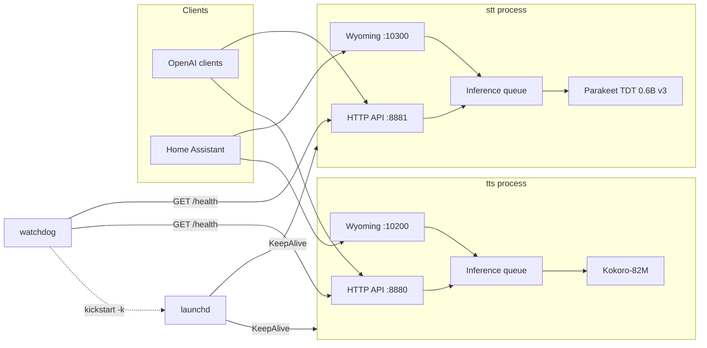

# voiced

Local speech-to-text and text-to-speech server for Apple Silicon. Models run
on the GPU through MLX and stay resident in memory, so there are no cold
starts. voiced exposes an OpenAI-compatible HTTP API and the Wyoming protocol
for Home Assistant, runs as a launchd daemon that starts at boot without a
GUI login, and recovers from crashes and hangs on its own.

**Status:** pre-alpha. The interfaces are frozen and the skeleton runs with
fake engines; the real engines, the installer and the Home Assistant
integration are being merged. Do not deploy yet.

## Quickstart

Requires an M-series Mac, macOS 14 or newer, and Python 3.11 to 3.13.

```sh
brew install espeak-ng ffmpeg
uv tool install "voiced[stt,tts]"   # or: pipx install "voiced[stt,tts]"
voiced install
```

<!-- TODO(phase2): verify the install command once voiced is on PyPI -->

`voiced install` creates the service environment, downloads the models,
writes the launchd plists and prints a short script. Run that script with
`sudo` (it only copies the plists into `/Library/LaunchDaemons` and loads
them; voiced never runs root steps for you). Then:

```sh
voiced status
curl -s http://127.0.0.1:8880/health
```

Both services report `"status": "ok"` once their model is warm. Try them:

```sh
curl -s http://127.0.0.1:8880/v1/audio/speech \
  -H 'Content-Type: application/json' \
  -d '{"model": "kokoro", "input": "Hello from voiced.", "voice": "af_heart"}' \
  -o hello.wav

curl -s http://127.0.0.1:8881/v1/audio/transcriptions \
  -F file=@hello.wav -F model=parakeet
```

## What you get

| Endpoint | Service | Port | Purpose |
|---|---|---|---|
| `POST /v1/audio/transcriptions` | stt | 8881 | Transcribe a file (json, text, verbose_json, srt, vtt) |
| `WS /v1/audio/transcriptions/stream` | stt | 8881 | Live transcription with partial and final events |
| `POST /v1/audio/speech` | tts | 8880 | Synthesize text (wav, pcm, mp3, opus); `pcm` streams |
| `GET /v1/audio/voices` | tts | 8880 | List voices |
| `GET /v1/models` | both | | Installed model, languages, license |
| `GET /health` | both | | Model loaded, queue depth, last inference |
| `GET /` | both | | Status page |
| Wyoming STT | stt | 10300 | Home Assistant speech-to-text |
| Wyoming TTS | tts | 10200 | Home Assistant text-to-speech, streaming |

Every port is configurable. The full HTTP reference, including the WebSocket
message schema and error shapes, is in [docs/api.md](docs/api.md). The Home
Assistant walkthrough is in [docs/home-assistant.md](docs/home-assistant.md).

Works unmodified with the official `openai` clients, LiteLLM, Open WebUI and
anything else that speaks the OpenAI audio API:

```python
from openai import OpenAI

client = OpenAI(base_url="http://127.0.0.1:8880/v1", api_key="unused")
audio = client.audio.speech.create(model="kokoro", voice="af_heart", input="Hello.")
audio.write_to_file("hello.wav")
```

## Architecture



Two processes, one package. Each process loads one model, serves it over HTTP
and Wyoming from the same event loop, and serializes GPU work through a
bounded queue. launchd restarts a process that exits; the watchdog restarts
one that stops answering. Engines are entry-point plugins behind a frozen
interface. Details, including the audio conventions and how to add an
engine, are in [docs/architecture.md](docs/architecture.md).

## Configuration

One file, `~/.config/voiced/config.toml`, plus environment variables that
override it. Every key has a default, so the services start with no file at
all. [`config.example.toml`](config.example.toml) lists every key with its
default and a comment.

Environment variables are named `VOICED_<SECTION>__<KEY>`:

```sh
VOICED_SERVER__BIND=0.0.0.0
VOICED_TTS__DEFAULT_VOICE=bf_emma
VOICED_STT__LANGUAGES='["en"]'    # lists are JSON
VOICED_CONFIG=/path/to/other.toml # use a different config file
```

`voiced config` prints the effective configuration as JSON.

### Security note on `bind`

Both services bind to `127.0.0.1` by default and are reachable only from the
Mac itself. Home Assistant on another machine needs `bind = "0.0.0.0"`, which
exposes the services to your whole network:

- The HTTP API has no authentication unless `api_key` is set. Set it before
  you bind to the LAN.
- The Wyoming protocol has no authentication at all. Only expose it on a
  network you trust.
- voiced does no TLS. Put a reverse proxy in front if you need HTTPS.

## Models and licenses

Weights are not vendored. Each engine downloads its model from Hugging Face
on first run into the standard Hugging Face cache.

| Model | Role | Default | Weights license |
|---|---|---|---|
| [Parakeet TDT 0.6B v3](https://huggingface.co/mlx-community/parakeet-tdt-0.6b-v3) | STT | yes | CC-BY-4.0 |
| [Kokoro-82M](https://huggingface.co/mlx-community/Kokoro-82M-bf16) | TTS | yes | Apache-2.0 |
| Soprano-80M | TTS | no, selectable | see model card <!-- TODO(phase2): verify with the TTS worker --> |

CC-BY-4.0 requires attribution to NVIDIA when you redistribute Parakeet
output or the weights. Kokoro's phonemizer uses espeak-ng, which is GPL-3.
voiced does not include espeak-ng's source or link against it; it is an
external program you install with Homebrew and voiced calls it as a
dependency, so the voiced code itself stays MIT. If you redistribute a bundle
that includes espeak-ng, the GPL applies to that bundle.

## Benchmarks

Warm model, local request, measured with the scripts in `scripts/`
<!-- TODO(phase2): verify script location --> on an otherwise idle machine.
"First audio" is the time to the first PCM chunk of a three-sentence text;
"short synth" is a complete six-word sentence.

| Metric | M1 Max MacBook Pro, 64 GB, macOS 15.7 | M1 Max Mac Studio, 32 GB, macOS 27 |
|---|---|---|
| Kokoro short synth | 92 ms (RTF 0.039) | pending |
| Kokoro first audio over HTTP | about 160 ms | pending |
| Soprano short synth | 133 ms (RTF 0.085) | pending |
| Streaming STT finalize after 200 ms silence endpoint | about 3 ms | pending |
| Voice round trip (endpoint, STT, local LLM first clause, first audio) | 552 ms median | pending |
| TTS resident memory, Kokoro and Soprano loaded | about 0.55 GB | pending |

The round trip used a local Ollama model as the conversation agent; the
local parts (endpoint, STT, TTS) add up to roughly 280 to 380 ms, so a remote
LLM that answers within about 600 ms keeps the whole turn under one second.

## Troubleshooting

Start with `voiced doctor`. It checks Apple Silicon, the macOS version,
espeak-ng, ffmpeg, Metal access from a daemon context, free memory, port
conflicts and FileVault.

| Symptom | Likely cause and fix |
|---|---|
| `/health` returns 503 with `"status": "starting"` | The model is still loading or downloading. First start can take minutes; watch `voiced logs`. |
| `/health` says `"degraded"` | The last inference raised. The error is in `last_error`; the watchdog restarts the service if it keeps failing. |
| HTTP 503 `server_busy` | The inference queue is full. Raise `queue_depth` in the config or send fewer concurrent requests. |
| HTTP 401 | `api_key` is set; send `Authorization: Bearer <key>`. |
| Kokoro produces garbage or fails with a phonemizer error | espeak-ng is missing (`brew install espeak-ng`) or the service venv sits at a long path. espeak breaks on long paths; `voiced install` uses a short one for this reason. |
| Transcription fails with a decode error | ffmpeg is missing (`brew install ffmpeg`) or the upload is not audio. |
| Home Assistant does not discover voiced | `bind` is still `127.0.0.1`, or mDNS does not cross your VLAN. Set `bind = "0.0.0.0"` or add the integration by host and port. |
| Services do not come up after a reboot | FileVault is on: launchd cannot start anything until the disk is unlocked at the login screen. No GUI login is needed after that. |
| Port already in use | Another service owns 8880, 8881, 10200 or 10300. Change the port in the config; `voiced doctor` names the conflicting process. |
| MLX cannot find the GPU under launchd | Run `voiced doctor` to probe Metal from a daemon context and read [docs/operations.md](docs/operations.md). |

Logs live under `~/Library/Logs/voiced/`. More in
[docs/operations.md](docs/operations.md).

## Roadmap

Version 1 ships English only with Parakeet and Kokoro. Everything else is a
plugin:

- More languages: engines advertise their languages, and the server
  intersects them with the configured list, so adding a language is an
  engine concern.
- More engines: Whisper, Piper, Pocket TTS and any other model can be added
  as a separate package that declares a `voiced.stt_engines` or
  `voiced.tts_engines` entry point. See
  [docs/architecture.md](docs/architecture.md#adding-an-engine).
- Semantic end-of-turn detection as a pluggable endpointing hook.
- A Homebrew tap.

Ideas and requests go in the
[issue tracker](https://github.com/JulianBeaulieu/voiced/issues).

## Documentation

| Document | Contents |
|---|---|
| [docs/api.md](docs/api.md) | HTTP and WebSocket reference with curl and Python examples |
| [docs/home-assistant.md](docs/home-assistant.md) | Wyoming setup, Assist pipeline, Ollama as the conversation agent |
| [docs/architecture.md](docs/architecture.md) | Processes, queue, health, watchdog, engine registry, adding an engine |
| [docs/operations.md](docs/operations.md) | launchd, logs, FileVault, memory budget, GPU wired limit |
| [docs/decisions/](docs/decisions/README.md) | Architecture decision records |
| [CONTRIBUTING.md](CONTRIBUTING.md) | Development setup, tests, conventions |
| [CHANGELOG.md](CHANGELOG.md) | Release notes |

## License

MIT. See [LICENSE](LICENSE). Model weights and espeak-ng have their own
licenses, listed above.
