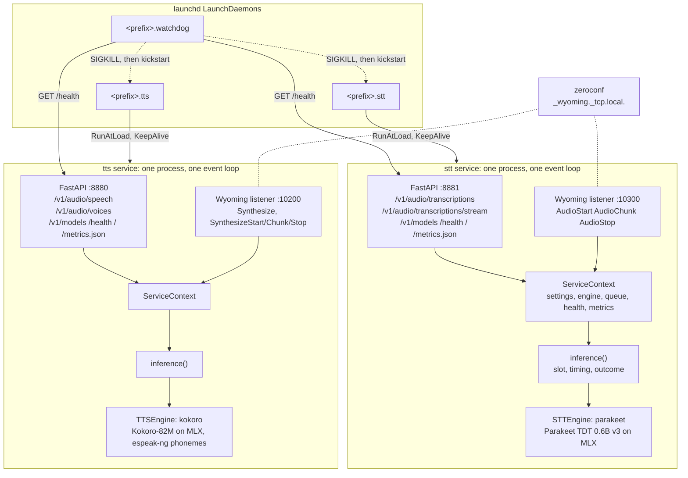

# Architecture

voiced is one Python package that runs as two services on an Apple Silicon
Mac. Each service is one long-lived process that loads one model onto the
GPU through MLX, keeps it resident (unless `idle_unload_s` says to unload
it while unused), and serves it over two protocols from one event loop. This page explains the pieces; the decision records under
[decisions/](decisions/README.md) explain why.

## Services



Two services rather than one so that a crash or hang in one modality does
not take down the other, and so the watchdog can restart them independently.
They never share a loaded model, which costs nothing because they load
different ones. The module map is in
[ADR 0001](decisions/0001-project-structure.md); the parts that matter for
understanding a request are below.

## Startup

The FastAPI lifespan starts the engine's `load()` as a background task and
returns at once, so the HTTP port and the Wyoming port are bound within a
second of the process starting. Until the load finishes, `/health` answers
`503` with `status: "starting"` and every `/v1` route and Wyoming request
answers `server_busy`. `load()` loads the weights from the Hugging Face
cache and runs a warm-up inference, so "healthy" means "warm". The services
run with `HF_HUB_OFFLINE=1` and never download: a catalogued engine reads
its model through `voiced.models.snapshot(model_id, check_only=True)`, and
a plugin engine's own download fails offline. A model that is not in the
cache (`ModelNotDownloaded`, or the hub's offline and not-found errors)
leaves the process up with `status: "missing_model"`; `voiced models
download` or `voiced install` fetches it.

If `load()` raises, the process logs the traceback and exits with status 1,
so launchd restarts it. A stop request during a load exits immediately
rather than waiting for a load thread that cannot be interrupted.

A service switched off (`enabled = false`) does none of this: `voiced
serve` writes its pid to `<state dir>/<service>.off` and waits for launchd
to stop it, with no engine and no ports, and the watchdog takes that pid
for `off` (`voiced.launchd.parked`).

## Model residency

`voiced.residency.Residency` owns every `load()` and `unload()` of the
engine. With `idle_unload_s` above 0, a timer unloads the model once that
long has passed since the last request and the queue is empty; `/health`
says `idle`. `inference()` calls `Residency.ensure_loaded()` once it holds
the slot, so the next request, on any transport, waits while the model
loads again (`loading`) and is then served; an unload never overlaps a
request. Measurements and the engine contract are in
[ADR 0033](decisions/0033-model-residency.md).

## Request path

1. A request arrives over HTTP or Wyoming. Both handlers get the same
   `ServiceContext` (settings, engine, queue, health, metrics) from the app.
2. The transport validates and decodes the input outside the GPU slot:
   ffmpeg turns an upload into mono float32 16 kHz; `voiced.audio` converts
   Wyoming PCM of any width, channel count and rate to the same format;
   `voiced.text.normalize` strips Markdown before TTS and, for English
   voices, spells out numbers, times, units and acronyms; other languages
   keep digits and symbols as written (ADR 0023). Errors here (a bad field,
   an oversized upload) never reach metrics or health.
3. The engine call runs inside `async with inference(ctx, operation):` from
   `voiced.inference`. It takes the queue slot, times the block, records the
   outcome in health and metrics, and re-raises. It is the only code that
   writes either.
4. Blocking MLX work runs through `voiced.threads.run_blocking`, which keeps
   the event loop free and, unlike `asyncio.to_thread`, holds the slot until
   the thread finishes even when the caller is cancelled. A cancelled client
   therefore cannot start a second MLX call next to a running one. Parakeet
   and every `SentenceTTSEngine` use `voiced.threads.ModelThread`, the same
   rule on one dedicated thread, because an MLX stream belongs to the thread
   that created it.
5. The transport maps the outcome to its wire format with one table: the
   HTTP status and error type, the WebSocket close code, or the Wyoming
   `Error` code.

| Outcome | Raised by | Health | HTTP | Wyoming |
|---|---|---|---|---|
| `ok` | nothing | last inference updated | 200 | result event |
| `busy` | queue full, model loading | untouched | 503 `server_busy` | `server_busy`, close |
| `client_error` | `EngineError` (unknown voice, unsupported language, bad audio) | untouched | 400 | `invalid_request_error` |
| `disconnect` | the client hung up or timed out | untouched | nothing sent | nothing sent, close |
| `failure` | anything else | `degraded` | 500 `server_error` | `engine_error`, close |

The full rules, including the obligations of streaming transports, are in
[ADR 0005](decisions/0005-shared-inference-and-audio-primitives.md).

## Streaming and timeouts

Every socket read or write made while holding the GPU slot is bounded:
reads by `server.session_idle_s` (default 30 s), writes by
`server.write_timeout_s` (default 10 s). Running out of time is a
`disconnect`, so a silent or half-open client releases the GPU instead of
pinning it.

| Stream | Holds the slot |
|---|---|
| WebSocket transcription | from the accepted connection to `final` |
| Wyoming STT utterance | from `AudioStart` to `Transcript`, with size and wall-clock limits ([details](api.md#wyoming-protocol)) |
| HTTP speech | while synthesizing; the response is delivered from a buffer after the slot is released |
| Wyoming streaming TTS | one sentence at a time, so a conversation agent pausing between sentences does not block others |

HTTP speech runs the engine in its own task that feeds the response body
through a queue. The route waits for the first chunk before sending
headers, so a full queue is still a 503 and an unknown voice still a 400.
A client that hangs up while the engine is producing stops the task at the
next chunk, which is counted as a `disconnect`; a client that stops reading
is cut off after the write timeout ([ADR 0007](decisions/0007-http-api.md)).

## Inference queue

MLX runs one kernel stream per process and model objects are not
thread-safe, so each service runs its inference through one bounded FIFO
queue, `voiced.queue.InferenceQueue`:

- `async with queue.slot():` holds the GPU for the block. `inference()` is
  its only caller.
- A slot is exclusive by default: one holder at a time. A stream session
  (`Operation.STREAM`) takes a shared slot instead: up to `max_shared` such
  holders run at once, and the engine interleaves their work on its model
  thread ([ADR 0020](decisions/0020-concurrent-stt-streams.md)). For STT
  that is `stt.streams` (default 2), at most `queue_depth` and the engine's
  `max_streams` (1 unless the engine declares more; Parakeet does). An
  exclusive holder, such as a batch transcription, waits until no shared
  holder is left. Admission stays FIFO, so neither kind overtakes the
  other.
- `depth` counts requests waiting or running. When it reaches `capacity`
  (config `queue_depth`, default 8 per service), `slot()` raises
  `QueueFull` at once instead of waiting.
- A task that already holds the slot and asks for it again gets a
  `RuntimeError` rather than deadlocking.

A client that disconnects while waiting leaves the queue without running.

## Health and metrics

Each service keeps one `HealthState` that `GET /health` serializes; the
fields and the `starting`, `ok` and `degraded` rules are in the
[API reference](api.md#get-health). Only a `failure` outcome makes a service
`degraded`; a stream of bad requests cannot make the watchdog restart a
healthy model. `voiced.metrics` keeps per-operation outcome counts, p50 and
p95 latency over the last 1000 successful inferences and the last 50 errors,
in memory, for the status page.

## launchd and the watchdog

Three LaunchDaemons, `io.github.julianbeaulieu.voiced.stt`, `.tts` and
`.watchdog`, rendered as root from the user name alone by the one privileged
script that `voiced install` prints and the menu bar app runs
([ADR 0018](decisions/0018-install-from-the-menu-bar-app.md)). launchd starts them at boot with no GUI login and
restarts a service that exits. The watchdog, a third daemon, polls `/health`
and restarts a service that is alive but stuck: a hung load, a queue that
stops draining, or a service that stays `degraded`. It runs as the
installing user, not root, and restarts a service by killing its process and
asking launchd to start it again. The plist keys, the restart rules and the
Metal probe are documented in [operations.md](operations.md#launchd).

## Engine registry

Engines are discovered through Python entry points in two groups,
`voiced.stt_engines` and `voiced.tts_engines`. The entry-point name is the
`engine` value in the config. `voiced.engines.registry` reads the installed
entry points on every lookup, so a newly installed plugin package is visible
without a reinstall of voiced. An `engine` name that is not installed stops
the service at startup with the list of installed names.

Registered engines:

| Name | Group | Engine |
|---|---|---|
| `parakeet` | `voiced.stt_engines` | Parakeet TDT 0.6B v3 via `parakeet-mlx`, batch and streaming, the default ([ADR 0008](decisions/0008-stt-engine-parakeet.md)) |
| `kokoro` | `voiced.tts_engines` | Kokoro-82M via MLX with espeak-ng phonemes, the default ([ADR 0009](decisions/0009-tts-kokoro-espeak-tokens.md)) |
| `soprano` | `voiced.tts_engines` | Soprano-80M via mlx-audio, opt-in, with a repetition penalty and a per-sentence length bound against runaway generation ([ADR 0010](decisions/0010-tts-soprano.md)) |
| `phonon` | `voiced.tts_engines` | Phonon 31M via `ptts` on the CPU, opt-in, each sentence streamed as it is decoded ([ADR 0021](decisions/0021-tts-phonon.md)) |
| `pocket` | `voiced.tts_engines` | Kyutai's Pocket TTS via mlx-audio on the GPU, opt-in, each 80 ms frame streamed as it is decoded ([ADR 0028](decisions/0028-tts-pocket.md)) |
| `chatterbox` | `voiced.tts_engines` | Chatterbox Turbo via mlx-audio, opt-in, each sentence rendered in pieces as its speech tokens arrive ([ADR 0029](decisions/0029-tts-chatterbox-turbo.md)) |
| `qwen3-asr` | `voiced.stt_engines` | Qwen3-ASR 0.6B or 1.7B via mlx-audio, opt-in, batch with the forced aligner's sentence times; a stream is transcribed at finalize ([ADR 0027](decisions/0027-stt-qwen3-asr.md)) |
| `moonshine` | `voiced.stt_engines` | Moonshine Streaming via `moonshine-voice` (ONNX Runtime) on the CPU, opt-in, macOS 15 and later, finalized on the client's `end` ([ADR 0026](decisions/0026-stt-moonshine.md)) |
| `omnivoice` | `voiced.tts_engines` | OmniVoice via mlx-audio, opt-in, 646 languages and designed voices, about 0.8 s to first audio, four times the 200 ms target ([ADR 0030](decisions/0030-tts-omnivoice.md)) |
| `nemotron` | `voiced.stt_engines` | Nemotron ASR streaming (3.5 multilingual, or English) via mlx-audio, opt-in, cache-aware: each chunk is encoded once ([ADR 0025](decisions/0025-stt-nemotron.md)) |
| `marvis` | `voiced.tts_engines` | Marvis via mlx-audio's `sesame` model on the GPU, opt-in, English, French and German reference-clip voices, each 80 ms frame streamed as it is decoded ([ADR 0031](decisions/0031-tts-marvis.md)) |
| `whisper` | `voiced.stt_engines` | Whisper large-v3-turbo via mlx-audio, opt-in, 100 languages, batch with word-timed segments; a stream is transcribed at finalize, about half a second after the turn ([ADR 0032](decisions/0032-stt-whisper-turbo.md)) |
| `fake` | both | Deterministic fakes from `voiced.testing`, used by the test suite |

Sentence-at-a-time TTS engines can subclass `voiced.engines.sentence.SentenceTTSEngine`,
which provides `load()`, the loaded, voice and speed checks and the
split-synthesize-yield loop; Kokoro, Soprano, Phonon, Pocket TTS and OmniVoice do. An
engine that decodes a sentence in pieces also overrides `_synth_chunks`, and
the loop yields each piece as it comes (Phonon, Pocket TTS). The load and
every step of a sentence run on the engine's one `ModelThread`, since a
streaming engine keeps MLX arrays from one piece to the next. When a request
is cancelled during a step, the loop calls the engine's `_interrupt()`, so an
engine whose step is a whole sentence can stop it early (OmniVoice, ADR
0030).

The MLX engines live in the optional extras `stt` and `tts`, Phonon in
`phonon` and Moonshine in `moonshine`, so the core package installs on any
machine and CI runs against the fakes. The shipped lock carries all four
extras; `moonshine-voice` carries a marker that skips it before macOS 15.

## Engine interfaces

`voiced/engines/base.py` defines the contract. It is frozen; the HTTP layer,
the Wyoming layer and every engine depend on it.

```python
class STTEngine:
    name: str; model_id: str; languages: list[str]; license: str
    async def load(self) -> None
    async def transcribe(self, audio: AudioInput, language: str | None = None) -> Transcript
    async def stream(self, language: str | None = None) -> STTStreamSession

class STTStreamSession:
    async def add_audio(self, samples: NDArray[np.float32]) -> None
    def partial(self) -> str
    async def finalize(self) -> Transcript
    async def close(self) -> None

class TTSEngine:
    name: str; model_id: str; languages: list[str]; license: str
    async def load(self) -> None
    async def voices(self) -> list[Voice]
    def synthesize(self, text: str, voice: str, speed: float = 1.0) -> AsyncIterator[PCMChunk]
```

Rules every engine follows:

- All methods are `async`. Every blocking model call, including the ones in
  `load()`, goes through `voiced.threads.run_blocking`, or through a
  `voiced.threads.ModelThread` when the engine keeps MLX streams, which are
  tied to the thread that created them. The server never
  calls two inference methods on one engine at once, so engines need no
  locking.
- `load()` is called once, before anything else, and must warm the model.
  It must not block the event loop, or `/health` stalls during the load.
- Errors the client caused (`UnknownVoice`, `UnsupportedLanguage`, bad
  input) are `EngineError` subclasses and become `400`. Any other exception
  is an engine failure: `500`, `degraded`, and possibly a restart. An engine
  should wrap its own subprocess pipe errors, which would otherwise look
  like a client disconnect.
- Cancellation follows asyncio. A disconnected client cancels the awaiting
  task; engines clean up in `finally` and never swallow `CancelledError`.
- `synthesize` is an async generator so the server can stop it early.
- `languages` are BCP-47 codes. The server matches them against the
  configured list and advertises the result in `/v1/models` and the Wyoming
  `Info` message. Adding a language is therefore an engine change, not a
  server change.

## Audio conventions

Fixed for the whole project, so engines and API layers can be written
independently:

| Direction | Format |
|---|---|
| STT input | mono float32 PCM, 16 000 Hz, range -1.0 to 1.0, one-dimensional numpy array |
| TTS output | mono signed 16-bit little-endian PCM, 24 000 Hz, `bytes`, in `PCMChunk` objects that concatenate directly |

Decoding uploads and encoding responses is the transport's job; engines
never see files or container formats. An engine that natively produces a
different rate resamples before yielding.

## Adding an engine

An engine is a separate package. It implements one of the two classes,
declares an entry point, and the user installs it into the same environment
as voiced: the one `~/.voiced/bin/voiced` links to. An update of voiced
builds a new environment, so install the engine again after one.

A sentence-at-a-time engine can subclass `SentenceTTSEngine` and supply
`_load_sync`, `_has_voice` and `_synth_sentence`; the base class runs them on
the engine's model thread. The example below implements `TTSEngine`
directly, so it runs its own blocking calls through `run_blocking`.

`my_package/piper.py`:

```python
from collections.abc import AsyncIterator

from voiced.engines.base import PCMChunk, TTSEngine, UnknownVoice, Voice
from voiced.text import split_sentences
from voiced.threads import run_blocking


class PiperEngine(TTSEngine):
    name = "piper"
    model_id = "rhasspy/piper-voices"
    languages = ["en", "de"]
    license = "MIT"

    async def load(self) -> None: ...  # load from the cache and warm up via run_blocking

    async def voices(self) -> list[Voice]:
        return [Voice(id="en_US-lessac-medium", name="Lessac", language="en-US")]

    def _synth(self, sentence: str, voice: str, speed: float) -> bytes: ...  # blocking

    async def synthesize(
        self, text: str, voice: str, speed: float = 1.0
    ) -> AsyncIterator[PCMChunk]:
        if voice not in {v.id for v in await self.voices()}:
            raise UnknownVoice(voice)
        for sentence in split_sentences(text):
            pcm = await run_blocking(self._synth, sentence, voice, speed)
            yield PCMChunk(data=pcm)  # int16 LE mono 24 kHz
```

`pyproject.toml` of that package, in the form `voiced/engines/registry.py`
documents (use `voiced.stt_engines` for a speech-to-text engine):

```toml
[project.entry-points."voiced.tts_engines"]
piper = "my_package.piper:PiperEngine"
```

Then in `~/.config/voiced/config.toml`:

```toml
[tts]
engine = "piper"
languages = ["en", "de"]
```

`synthesize` receives text already normalized for the voice's language:
English voices get numbers, units and acronyms as words, any other language
gets its digits and symbols as written, for the engine's own front end to
read (ADR 0023).

A speech-to-text engine starts `transcribe` with
`voiced.audio.stt_input(audio)`. It raises `EngineError` for input that is
not finite mono float32 at 16 kHz, and returns `None` when the input is
silent or shorter than `min_samples`; the engine then answers an empty
`Transcript` with `duration_s=audio.duration_s`. Pass `min_samples` when the
model cannot take shorter input. A streaming session checks each chunk in
`add_audio` with `voiced.audio.check_samples`. `voiced.engines.moonshine` is
a short example of both.

`voiced.testing.fakes` is the smallest complete implementation of both
interfaces and a good template; `voiced.engines.kokoro` is a real one built
on `SentenceTTSEngine`. The docstrings in `voiced/engines/base.py` are the
authoritative contract.
