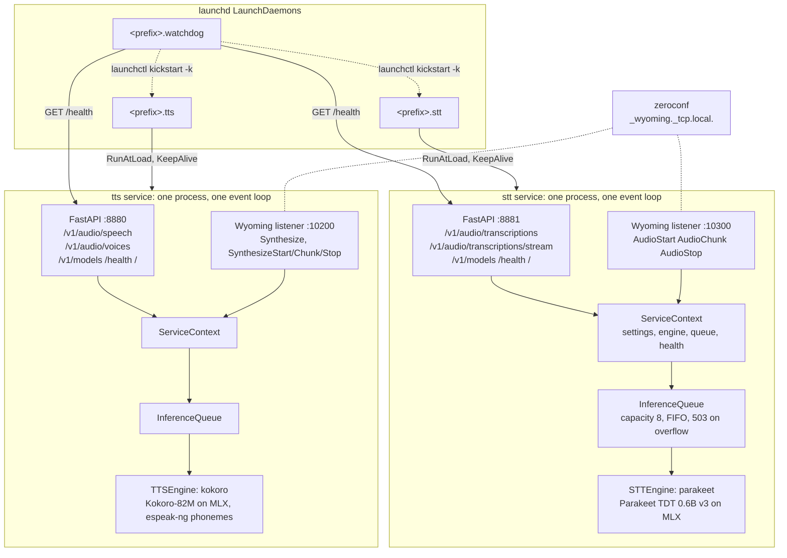

# Architecture

voiced is one Python package that runs as two services on an Apple Silicon
Mac. Each service is one long-lived process that loads one model onto the
GPU through MLX, keeps it resident, and serves it over two protocols from
one event loop. This page explains the pieces; the decision records under
[decisions/](decisions/README.md) explain why.

## Services



Two services rather than one so that a crash or hang in one modality does
not take down the other, and so the watchdog can restart them independently.
They never share a loaded model, which costs nothing because they load
different ones. Everything they have in common is in the top-level modules:

| Module | Role |
|---|---|
| `voiced.config` | `Settings`: one TOML file plus `VOICED_<SECTION>__<KEY>` environment overrides. Unknown keys are errors. |
| `voiced.logging` | Stderr plus a rotating file under `~/Library/Logs/voiced/`. |
| `voiced.health` | `HealthState` and the frozen `/health` schema. |
| `voiced.queue` | `InferenceQueue`: serialized, bounded, FIFO. |
| `voiced.engines` | The frozen engine interfaces and the entry-point registry. |
| `voiced.api` | FastAPI app factories, one per modality, and the `ServiceContext`. |
| `voiced.wyoming` | Wyoming listeners that attach to the app lifespan. |
| `voiced.stt`, `voiced.tts` | Wire the configured engine into an app. |
| `voiced.launchd` | Plist rendering, installer, watchdog. |
| `voiced.cli` | `voiced install`, `start`, `stop`, `status`, `logs`, `uninstall`, `doctor`, `serve`, `config`. |
| `voiced.testing` | Fake engines so every layer above is testable without a model. |

## Request path

1. A request arrives over HTTP or Wyoming. Both handlers get the same
   `ServiceContext` (settings, engine, queue, health) from the app state.
2. The HTTP layer decodes the input: ffmpeg turns any upload into mono
   float32 16 kHz for STT; text is normalized (numbers, times, acronyms,
   markdown) for TTS. The Wyoming layer converts incoming PCM of any width,
   channel count and rate to the same STT format.
3. The handler takes a slot in the `InferenceQueue`. If the queue is at
   capacity the request fails immediately: HTTP `503` with `Retry-After`, or a
   Wyoming `Error` with code `queue_full`. Otherwise it waits its turn.
4. The engine runs. Blocking MLX calls happen in a thread via
   `asyncio.to_thread`, so the event loop keeps serving `/health` and
   accepting connections.
5. The handler encodes the output (WAV, MP3, Opus, subtitle formats, Wyoming
   events) and records the duration in `HealthState`. An engine exception
   marks the service `degraded`.

Streaming requests hold their slot for the whole stream: the WebSocket
endpoint and the Wyoming STT session hold it from first audio to finalize.
Streaming TTS over Wyoming takes one slot per sentence instead, so a
conversation agent that pauses between sentences does not block the GPU for
everyone else.

## Inference queue

MLX runs one kernel stream per process and model objects are not
thread-safe, so each service runs exactly one inference at a time. The queue
is an `asyncio.Lock` with a counter in front of it:

- `async with queue.slot():` holds the GPU for the block. Used by streams.
- `await queue.run(fn, *args)` runs a blocking callable in a thread while
  holding a slot. Used by one-shot requests.
- When `depth` reaches `capacity` (config `queue_depth`, default 8 per
  service), `slot()` raises `QueueFull` without waiting.

A client that disconnects while waiting leaves the queue without running.
A call that already started runs to completion in its thread, but the slot
is released the moment it returns, so a cancelled client never wedges the
queue.

## Health

Each service keeps one `HealthState` that `GET /health` serializes; the
fields and the `starting`, `ok` and `degraded` rules are in the
[API reference](api.md#get-health). The engine's `load()` runs inside the
FastAPI lifespan before the Wyoming listener starts and before `/health`
turns 200. Engines download their weights if needed, load them, and run a
dummy inference, so "healthy" means "warm".

## launchd and the watchdog

`voiced install` renders three LaunchDaemon plists, `<prefix>.stt`,
`<prefix>.tts` and `<prefix>.watchdog`, with the prefix from
`[launchd] label_prefix`. launchd starts them at boot with no GUI login and
restarts a service that exits. The watchdog, a third daemon, polls `/health`
and restarts a service that is alive but no longer answers, which `KeepAlive`
alone cannot detect. The plist keys, the restart rules and the Metal probe
are documented in [operations.md](operations.md#launchd).

## Engine registry

Engines are discovered through Python entry points in two groups,
`voiced.stt_engines` and `voiced.tts_engines`. The entry-point name is the
`engine` value in the config. `voiced.engines.registry` reads the installed
entry points on every lookup, so a newly installed plugin package is visible
without a reinstall of voiced. `register_stt_engine` and
`register_tts_engine` add a class in-process, which tests use.

voiced itself registers:

| Name | Group | Class |
|---|---|---|
| `parakeet` | `voiced.stt_engines` | Parakeet TDT 0.6B v3 via `parakeet-mlx` |
| `kokoro` | `voiced.tts_engines` | Kokoro-82M via `mlx-audio` with espeak-ng phonemes |
| `soprano` | `voiced.tts_engines` | Soprano-80M via `mlx-audio` with a repetition penalty and duration cap |
| `fake` | both | Deterministic fakes from `voiced.testing`, used by the test suite |

<!-- TODO(phase2): verify the registered engines against main after the engine PRs merge -->

The MLX engines live in the optional extras `stt` and `tts`, so the core
package installs on any machine and CI runs against the fakes.

## Engine interfaces

`voiced/engines/base.py` defines the contract. It is frozen; the HTTP layer,
the Wyoming layer and every engine depend on it.

```python
class STTEngine:
    name: str; model_id: str; languages: list[str]; license: str
    async def load(self) -> None
    async def transcribe(self, audio: AudioInput, language: str | None = None) -> Transcript
    async def stream(self, language: str | None = None) -> STTStreamSession

class STTStreamSession:
    async def add_audio(self, samples: NDArray[np.float32]) -> None
    def partial(self) -> str
    async def finalize(self) -> Transcript
    async def close(self) -> None

class TTSEngine:
    name: str; model_id: str; languages: list[str]; license: str
    async def load(self) -> None
    async def voices(self) -> list[Voice]
    def synthesize(self, text: str, voice: str, speed: float = 1.0) -> AsyncIterator[PCMChunk]
```

Rules every engine follows:

- All methods are `async`. Blocking work goes through `asyncio.to_thread`.
  The server never calls two inference methods on one engine at once, so
  engines need no locking.
- `load()` is called once, before anything else, and must warm the model.
- Errors the client caused (`UnknownVoice`, `UnsupportedLanguage`, bad
  input) are `EngineError` subclasses and become `400`. Any other exception
  is an engine failure: `500`, `degraded`, and possibly a restart.
- Cancellation follows asyncio. A disconnected client cancels the awaiting
  task; engines clean up in `finally` and never swallow `CancelledError`.
- `synthesize` is an async generator so the server can stop it early.
- `languages` are BCP-47 codes. The server intersects them with the
  configured list and advertises the result in `/v1/models` and the Wyoming
  `Info` message. Adding a language is therefore an engine change, not a
  server change.

## Audio conventions

Fixed for the whole project, so engines and API layers can be written
independently:

| Direction | Format |
|---|---|
| STT input | mono float32 PCM, 16 000 Hz, range -1.0 to 1.0, one-dimensional numpy array |
| TTS output | mono signed 16-bit little-endian PCM, 24 000 Hz, `bytes`, in `PCMChunk` objects that concatenate directly |

Decoding uploads and encoding responses is the API layer's job; engines
never see files or container formats. An engine that natively produces a
different rate resamples before yielding.

## Adding an engine

An engine is a separate package. It implements one of the two classes,
declares an entry point, and the user installs it into the same environment
as voiced.

`my_package/piper.py`:

```python
import asyncio
from collections.abc import AsyncIterator

from voiced.engines.base import PCMChunk, TTSEngine, UnknownVoice, Voice


class PiperEngine(TTSEngine):
    name = "piper"
    model_id = "rhasspy/piper-voices"
    languages = ["en", "de"]
    license = "MIT"

    async def load(self) -> None: ...  # download, load, warm up

    async def voices(self) -> list[Voice]:
        return [Voice(id="en_US-lessac-medium", name="Lessac", language="en-US")]

    async def synthesize(
        self, text: str, voice: str, speed: float = 1.0
    ) -> AsyncIterator[PCMChunk]:
        if voice not in {v.id for v in await self.voices()}:
            raise UnknownVoice(voice)
        for sentence in split(text):
            pcm = await asyncio.to_thread(self._synth, sentence, voice, speed)
            yield PCMChunk(data=pcm)  # int16 LE mono 24 kHz
```

`pyproject.toml` of that package, in the form `voiced/engines/registry.py`
documents (use `voiced.stt_engines` for a speech-to-text engine):

```toml
[project.entry-points."voiced.tts_engines"]
piper = "my_package.piper:PiperEngine"
```

Then in `~/.config/voiced/config.toml`:

```toml
[tts]
engine = "piper"
languages = ["en", "de"]
```

`voiced doctor` lists the engines it can see. `voiced.testing.fakes` is the
smallest complete implementation of both interfaces and a good template; the
docstrings in `voiced/engines/base.py` are the authoritative contract.
